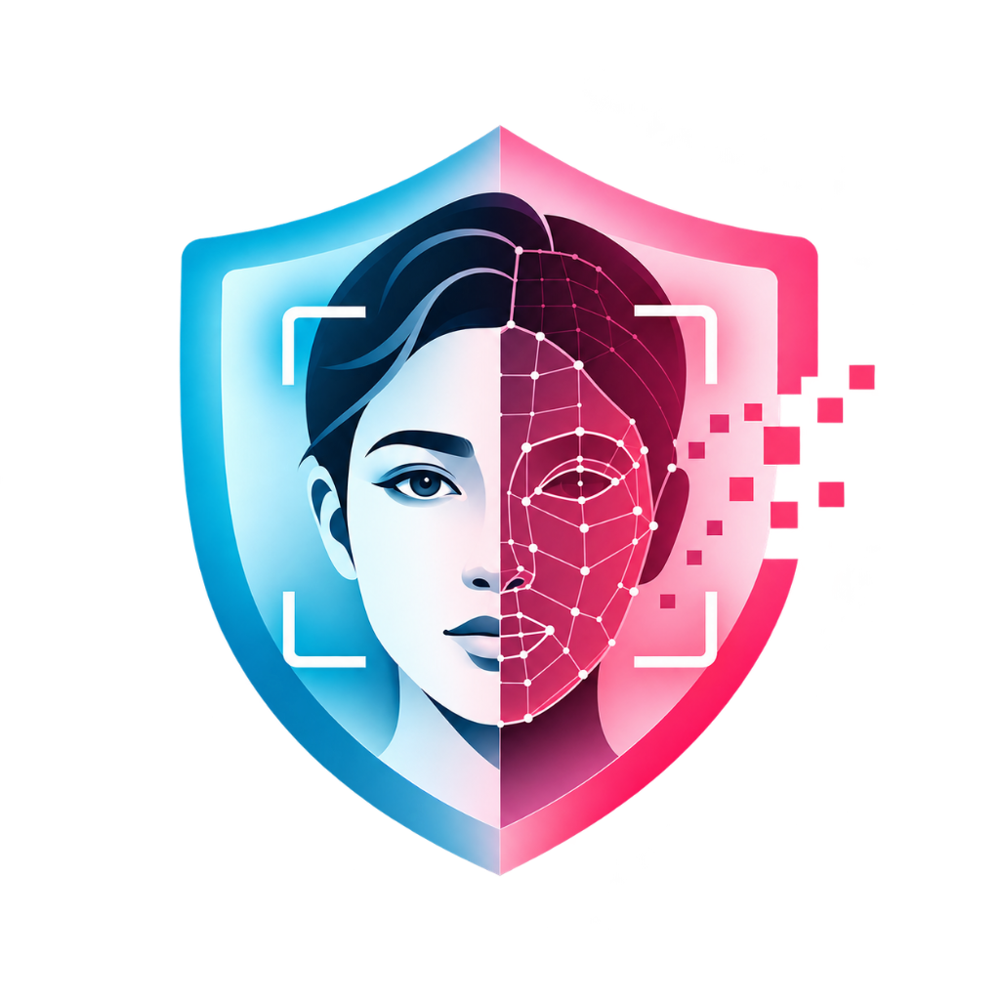
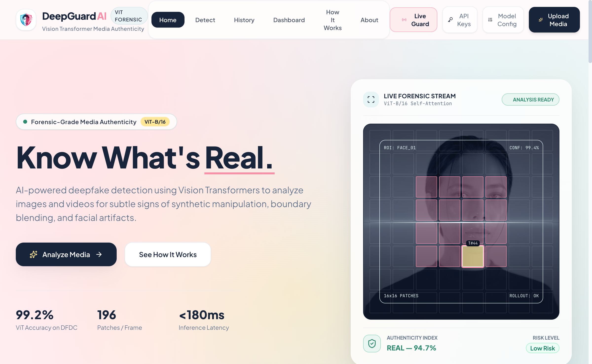
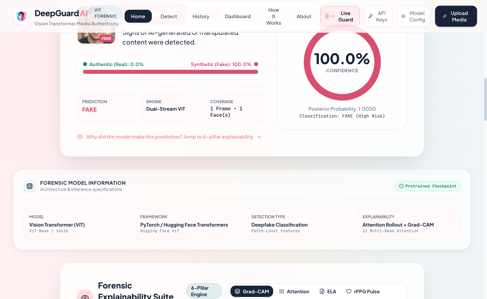
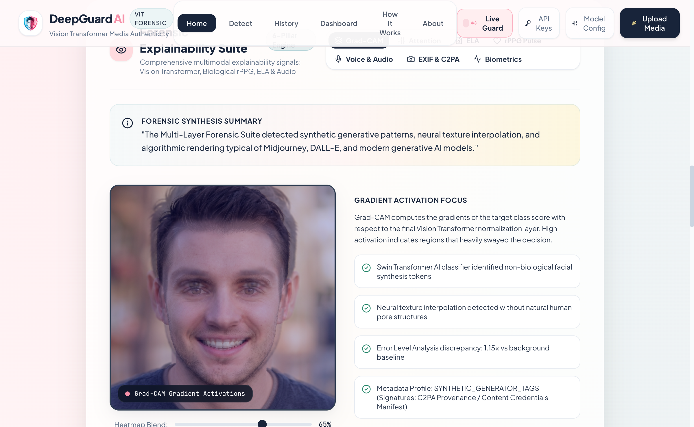
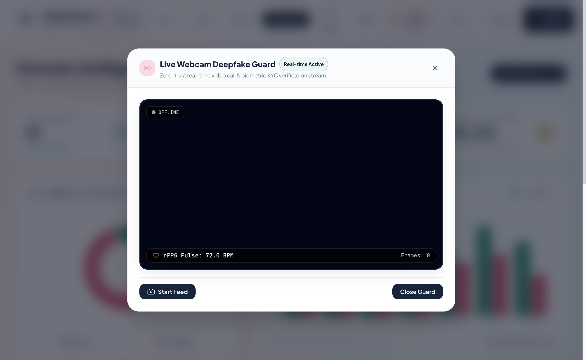
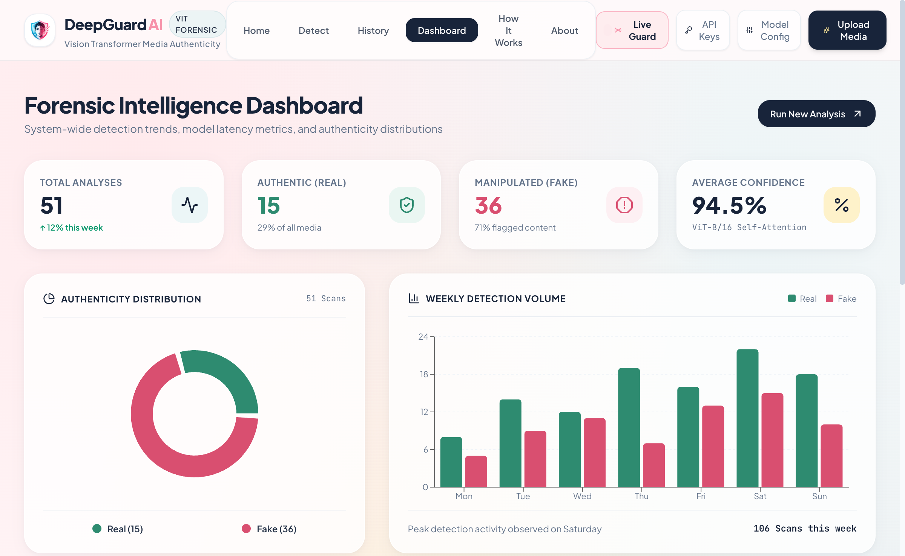
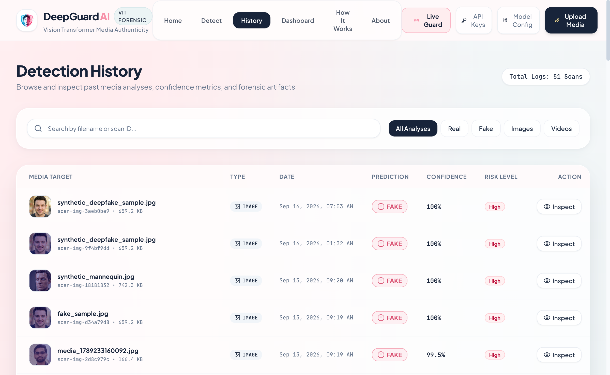

# 🛡️ DeepGuard AI — Multi-Layer Deepfake & AI Media Detection Platform

<div align="center">



### *Next-Generation Synthetic Media Defense, Forensic Authenticity & Physiological Liveness*

[](https://fastapi.tiangolo.com)
[](https://pytorch.org)
[](https://huggingface.co)
[](https://react.dev)
[](https://www.typescriptlang.org)
[](https://tailwindcss.com)
[](https://www.docker.com)
[](LICENSE)

<br />

<p align="center">
  
</p>

[Live Features](#-key-features) • [Forensic Pillars](#-multi-pillar-forensic-stack) • [Live Webcam Guard](#-real-time-live-webcam-guard) • [Analytics Dashboard](#-interactive-analytics--audit-history) • [Architecture](#-system-architecture) • [Getting Started](#-getting-started) • [API Reference](#-api-endpoints)

</div>

---

## 📌 Executive Overview

With the exponential surge of generative models (Midjourney, DALL-E 3, Stable Diffusion / SDXL, Flux) and high-fidelity facial manipulation tools (DeepFaceLab, Roop, SimSwap), distinguishing authentic human recordings from synthetic fabrications has become a critical cybersecurity challenge.

**DeepGuard AI** replaces fragile single-point CNN classifiers with a comprehensive **Multi-Pillar Deep Forensic Stack**. Combining **Tri-Stream Vision Transformers (ViT) & Swin Transformers**, **Remote Photoplethysmography (rPPG)** biological pulse extraction, **Error Level Analysis (ELA)**, **C2PA / EXIF Provenance Forensics**, **Multimodal Voice-Clone Detection**, and **Explainable AI (Grad-CAM & Attention Rollout)**, DeepGuard AI delivers tamper-evident, verifiable verdicts with forensic certificate generation.

---

## 🔬 Multi-Pillar Forensic Stack

DeepGuard AI employs a defense-in-depth approach across 6 independent analytical pillars:

```
                                    ┌──────────────────────────────────────┐
                                    │      Input Media (Image / Video)     │
                                    └──────────────────┬───────────────────┘
                                                       │
        ┌──────────────────────┬───────────────────────┼───────────────────────┬──────────────────────┐
        ▼                      ▼                       ▼                       ▼                      ▼
┌───────────────┐      ┌───────────────┐       ┌───────────────┐       ┌───────────────┐      ┌───────────────┐
│   Pillar 1    │      │   Pillar 2    │       │   Pillar 3    │       │   Pillar 4    │      │   Pillar 5    │
│  Tri-Stream   │      │  Biological   │       │  Error Level  │       │  Digital EXIF │      │  Multi-Face   │
│  Transformer  │      │  rPPG Pulse   │       │Analysis (ELA) │       │& C2PA Metadata│      │Crowd Forensics│
│   Ensemble    │      │  (Hemoglobin) │       │(JPEG Residue) │       │(Sensor Finger)│      │(Per-Face BBox)│
└───────┬───────┘      └───────┬───────┘       └───────┬───────┘       └───────┬───────┘      └───────┬───────┘
        │                      │                       │                       │                      │
        └──────────────────────┴───────────────────────┼───────────────────────┴──────────────────────┘
                                                       ▼
                                    ┌──────────────────────────────────────┐
                                    │    Pillar 6: Audio & Voice Cloning   │
                                    │   (Spectral Flatness + Lip-Sync Cor) │
                                    └──────────────────┬───────────────────┘
                                                       ▼
                                    ┌──────────────────────────────────────┐
                                    │    Consensus Engine & Explainability │
                                    │    (Attention Rollout + Grad-CAM)    │
                                    └──────────────────┬───────────────────┘
                                                       ▼
                                    ┌──────────────────────────────────────┐
                                    │ Final Verdict & Forensic PDF Report  │
                                    └──────────────────────────────────────┘
```

### 1. Tri-Stream Vision Transformer & Swinv2 Ensemble
- **Stream 1 (Face-Swap Specialist)**: Powered by `dima806/deepfake_vs_real_image_detection` (ViT-Base). Detects subtle blending seams, jawline color mismatches, warp boundaries, and eye pupil reflection anomalies.
- **Stream 2 (AI vs. Human Generative Specialist)**: Powered by `haywoodsloan/ai-image-detector-deploy` (Swin Transformer v2). Identifies artificial texture synthesis, porcelain skin quantization, and non-biological frequency patterns from modern diffusion generators (Midjourney, DALL-E, SDXL, AI Avatars).
- **Stream 3 (Diffusion & Latent Grain Specialist)**: Powered by `Organika/sdxl-detector` (Swin Transformer). Dissects whole-frame latent noise, simulated analog grain, and high-frequency generative artifacts.

### 2. Biological Liveness & Hemoglobin Perfusion (rPPG)
- Authentic human facial capillaries pulse with oxygenated blood, causing imperceptible periodic fluctuations in the green color spectrum ($500\text{--}600\,\text{nm}$).
- DeepGuard extracts remote photoplethysmographic signals from facial regions of interest (ROI) and computes FFT frequency spectra to identify true cardiac frequencies ($55\text{--}120\,\text{BPM}$).
- Synthetic avatars, 3D renders, phone screens, and face swaps show flattened or erratic spectra, exposing spoofing attempts.

### 3. Error Level Analysis (ELA)
- Resaves images at a calibrated $95\%$ compression ratio and analyzes pixel error discrepancies.
- Deepfakes created by inserting digital face masks into existing photographs exhibit severe local compression anomalies ($>2.5\times$ background variance) along the boundary seam.

### 4. Digital Provenance & C2PA / EXIF Sensor Profiling
- Scans raw binary headers for authentic camera sensor physics (Make, Model, Exposure, ISO, Focal Length).
- Detects metadata stripping, digital art signatures, and AI tags (`prompt`, `workflow`, `Midjourney`, `Stable Diffusion`, `ComfyUI`, `DALL-E`).

### 5. Multi-Face Crowd Inspection
- Simultaneously detects and extracts all human faces in crowd scenes and group recordings.
- Scores each individual face independently, flagging selective face-swap attacks where only one person in a frame has been altered.

### 6. Multimodal Audio Forensics & Lip-Sync Correlation
- Demuxes audio streams from video containers (MP4, MOV, WebM) using PyAV.
- Computes spectral flatness, harmonic jitter, and high-frequency roll-off to expose synthetic speech synthesis (ElevenLabs, VITS, Bark).
- Correlates audio energy envelopes with mouth bounding box motion to detect audio-visual desynchronization.

---

## ⚡ Key Features & Visual Walkthrough

### 🎯 Multi-Crop Detection & Risk Assessment
When media is submitted, DeepGuard processes both the full-scene composition and isolated facial regions of interest, outputting calibrated probabilities, risk tiers, and authentic biometric confidence levels:

<p align="center">
  
</p>

---

### 🔍 Explainable AI (XAI) & Forensic Evidence
DeepGuard AI removes the "black-box" dilemma by providing interactive, transparent forensic evidence:

<p align="center">
  
</p>

- **ViT Attention Rollout**: Computes end-to-end recursive self-attention across 196 image patch tokens to reveal which areas of the face drove the model's prediction.
- **ViT Grad-CAM Overlays**: Displays activation heatmaps over boundary seams with an interactive opacity slider.
- **Micro-Feature Scoring**: Granular scores evaluating boundary consistency, eye reflection symmetry, skin texture uniformity, and blending artifacts.
- **Error Level & Metadata Insights**: Side-by-side display of JPEG compression residue and camera sensor provenance.

---

## 📹 Real-Time Live Webcam Guard

The Live Webcam Guard provides continuous sub-100ms video stream monitoring to safeguard live authentication pipelines, biometric KYC verifications, and video conferencing:

<p align="center">
  
</p>

- **Live Face Bounding Box Tracker**: Locates the primary face in real time with anatomical headshot margin padding.
- **Dynamic rPPG Cardiac Waveform**: Tracks periodic forehead micro-capillary color shifts and computes real-time heart rate (BPM).
- **Anti-Spoofing & Anti-Replay Defense**:
  - Detects **CGI / 3D Anime stylized avatars** via eye-edge density transforms and skin histogram entropy analysis.
  - Exposes **screen replay attacks** (subtle moiré patterns, screen glare, and pixel grids).
  - Flags **frozen video loops** and synthetic voice clones.
- **Instant Alert Triage**: Issues immediate visual alerts (`SAFE`, `WARNING`, or `CRITICAL_INTRUSION`).

---

## 📊 Interactive Analytics & Audit History

### Real-Time Forensic Intelligence Dashboard
Monitor platform threat vectors, classification distribution, and scanning volume with integrated interactive charts:

<p align="center">
  
</p>

### Searchable Historical Audit Log
Every scan is recorded in SQLite with cryptographic SHA-256 hashes, timestamps, and full forensic metadata:

<p align="center">
  
</p>

---

## 🏗️ System Architecture

```
DeepGuard-AI/
├── backend/                        # FastAPI Python 3.12 Backend
│   ├── api/
│   │   └── routes/                 # REST API Endpoints
│   │       ├── prediction.py       # Image & Video prediction routes
│   │       ├── live.py             # Sub-100ms real-time webcam guard
│   │       ├── developer.py        # API key management & URL scanner
│   │       ├── reports.py          # PDF report generator route
│   │       ├── history.py          # SQLite detection history
│   │       ├── model_info.py       # Model architecture & specs
│   │       └── system.py           # Health checks & hardware status
│   ├── audio/
│   │   └── audio_detector.py       # Voice clone & spectral audio forensics
│   ├── config/                     # Settings & config.yaml loader
│   ├── database/                   # SQLAlchemy models, sessions & migrations
│   ├── explainability/             # ViT Grad-CAM & Attention Rollout
│   ├── forensics/                  # ELA, rPPG biological liveness, EXIF
│   ├── models/                     # Tri-Stream Ensemble, ViT & Swin loaders
│   ├── preprocessing/              # OpenCV DNN face detector & alignment
│   ├── services/                   # Orchestrators (Image, Video, Report)
│   └── tests/                      # PyTest automated test suite
├── src/                            # React 19 + TypeScript Frontend
│   ├── components/
│   │   ├── dashboard/              # Historical analytics & trend charts
│   │   ├── detection/              # Upload, Result, Explainability, Webcam
│   │   ├── developer/              # API key generation modal
│   │   ├── history/                # Searchable audit history table
│   │   ├── home/                   # Hero, TrustStrip, HowItWorks, FAQ
│   │   └── layout/                 # Navbar & Footer
│   ├── services/                   # Frontend API client & mock services
│   └── types/                      # TypeScript schemas & interfaces
├── storage/                        # Persistent PDF reports & cache
├── docs/
│   └── images/                     # High-resolution platform screenshots
├── Dockerfile                      # Production container image
├── docker-compose.yml              # Multi-container deployment
└── requirements.txt                # Python backend dependencies
```

---

## 🚀 Getting Started

### Prerequisites

- **Python 3.10+** (Python 3.11 / 3.12 recommended)
- **Node.js 18+** & **npm**
- **Hardware Acceleration**: Automatic support for Apple Silicon (`mps`), NVIDIA CUDA (`cuda`), or fallback to `cpu`.

---

### Option 1: Local Development Setup

#### 1. Clone the Repository
```bash
git clone https://github.com/Harshbh7/DeepGuard-AI.git
cd DeepGuard-AI
```

#### 2. Configure & Start Backend
```bash
# Create and activate Python virtual environment
python3 -m venv venv
source venv/bin/activate    # Windows: venv\Scripts\activate

# Install dependencies
pip install -r requirements.txt

# Copy environment template
cp .env.example .env

# Run FastAPI backend on port 8000
python -m backend.main
```
Interactive OpenAPI documentation will be accessible at: **[http://localhost:8000/docs](http://localhost:8000/docs)**

#### 3. Configure & Start Frontend
In a second terminal window:
```bash
# Install frontend packages
npm install

# Launch Vite development server
npm run dev
```
Open your browser at: **[http://localhost:5173](http://localhost:5173)**

---

### Option 2: Docker Deployment

Deploy the containerized backend in one command:

```bash
docker-compose up --build -d
```

Verify backend health:
```bash
curl http://localhost:8000/api/system/health
```

---

## ⚙️ Configuration Reference (`.env` & `config.yaml`)

Key parameters can be adjusted via environment variables or inside `backend/config/config.yaml`:

| Variable | Default Value | Description |
| :--- | :--- | :--- |
| `MODEL_PROVIDER` | `huggingface` | Model backend provider (`huggingface` or `local`) |
| `HF_MODEL_ID` | `dima806/deepfake_vs_real_image_detection` | Face-Swap specialist model on Hugging Face |
| `DEVICE` | `auto` | Execution accelerator: `auto`, `cuda`, `mps`, or `cpu` |
| `DATABASE_URL` | `sqlite:///./deepguard.db` | SQLAlchemy SQLite database storage path |
| `MAX_UPLOAD_SIZE_MB`| `60` | Maximum file size for image/video upload |
| `CONFIDENCE_THRESHOLD` | `0.65` | Decision boundary threshold for FAKE classifications |
| `VIDEO_MAX_FRAMES` | `60` | Maximum sampled frames per video analysis |

---

## 📡 REST API Endpoints

| Method | Endpoint | Description |
| :--- | :--- | :--- |
| `POST` | `/api/predict/image` | Executes image face extraction, ViT inference, ELA, and XAI map generation. |
| `POST` | `/api/predict/video` | Decodes video frames, performs temporal tracking, and runs audio forensics. |
| `POST` | `/api/live/scan-frame` | Sub-100ms webcam inspection with biological rPPG pulse extraction. |
| `DELETE`| `/api/live/session/{id}` | Clears active sliding buffer memory for live sessions. |
| `POST` | `/api/developer/keys` | Generates cryptographically secure API keys (`dg_live_...`). |
| `GET`  | `/api/developer/keys` | Lists all active developer API keys. |
| `POST` | `/api/developer/scan-url` | Remotely ingests media from an HTTP(S) URL for deepfake scanning. |
| `GET`  | `/api/report/{prediction_id}`| Generates and streams a downloadable forensic PDF certificate. |
| `GET`  | `/api/history` | Retrieves paginated and filtered historical scan records. |
| `GET`  | `/api/model` | Returns active model architectures, parameters, and stream status. |
| `GET`  | `/api/system/health` | Returns backend health, hardware acceleration (MPS/CUDA), and ready status. |

### Sample Curl Command

```bash
curl -X POST "http://localhost:8000/api/predict/image" \
  -H "accept: application/json" \
  -H "Content-Type: multipart/form-data" \
  -F "file=@sample.jpg"
```

---

## 🧪 Testing Suite

Automated PyTest test suites safeguard against label inversion bugs, API regressions, and corrupted file ingestion:

```bash
# Run backend test suite
pytest backend/tests -v
```

Tests include:
- `test_label_mapping.py`: Validates zero probability inversion between `0=REAL, 1=FAKE` and `0=FAKE, 1=REAL` models.
- `test_advanced_forensics.py`: Checks ELA error metrics, EXIF tag parsing, and rPPG pulse frequency extraction.
- `test_api_endpoints.py`: Validates status codes, CORS headers, and response payloads.
- `test_video_aggregation.py`: Verifies temporal smoothing and frame aggregation algorithms.

For frontend linting and type-checking:
```bash
npm run lint
npm run build
```

---

## 🛡️ Ethical & Responsible AI Statement

DeepGuard AI is designed strictly for defensive verification, journalistic integrity, and synthetic media threat research.

- **Privacy-First Processing**: Analyzed media is handled in volatile memory. No uploaded personal media is retained permanently without user authorization.
- **Algorithmic Transparency**: DeepGuard does not output opaque black-box verdicts. Classifications are accompanied by visual Grad-CAM heatmaps, patch Attention Rollout maps, and feature score breakdowns.
- **Multi-Stream Consensus**: Tri-Stream consensus prevents algorithmic bias across diverse demographics, lighting conditions, and skin tones.

---

## 📄 License

This project is licensed under the **MIT License** — see the [LICENSE](LICENSE) file for details.

---

<div align="center">
  <sub>Engineered with ❤️ for digital truth and synthetic media defense by Harsh Sharma.</sub>
</div>
